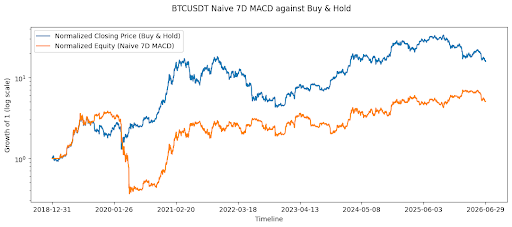

# Does a weekly (7D) MACD trend signal predict BTC returns?

Author: Darren Mark Effendy | NUS Quantitative Finance Y1.

## Summary

A naive 7D MACD strategy returns 409.87% after costs (Sharpe 0.68) against buy-and-hold's 1,483.21% (Sharpe 0.91) on BTCUSDT from 2018-12-31 to 2026-06-30 (UTC). An OLS regression of the h-day forward return (`fwd`) on the 7D MACD `state` gives a t-value that clears a shuffled-returns placebo bar at 0 of 5 horizons, so the effect, although positive at all 5 horizons, is not distinguishable from chance (null result). At the 20-day horizon (the middle of the five), the bull-minus-bear spread is 4.40% with t(HAC) at 2.12, below the 95 pct placebo bar |t| of 2.56. At this horizon, the effect is concentrated in the most bullish `hist` quintile (mean 9.69%, median 4.22%), and the spread is positive in 5 of 7 complete years (2019–2025). The null result shows that the 7D MACD signal's predictive power is indistinguishable from chance; combining the quintile table and bull-minus-bear spread shows that any effect comes mainly from the most bullish weeks, where a few large rallies within specific years lift the mean well above the median.

## Verdict: Placebo Bars

The table compares each real t(HAC) with the placebo bar: the 95th percentile of |t| from the same regression on 300 shuffled-return price paths. Shuffling removes any link between past and future returns, so the `state` has no true predictive power. Results from research.ipynb, sections 6 and 7.

| Horizon (days) | State b (%) | t (HAC) | Placebo bar (95th pct \|t\|) | P(\|t\| > 2) under null | Clears bar |
|---:|---:|---:|---:|---:|:---:|
| 5  | 0.52 | 2.08 | 2.48 | 0.12 | No |
| 10 | 1.13 | 2.24 | 2.50 | 0.10 | No |
| 20 | 2.20 | 2.12 | 2.56 | 0.11 | No |
| 30 | 2.87 | 1.86 | 2.53 | 0.11 | No |
| 40 | 3.69 | 1.76 | 2.60 | 0.12 | No |

Placebo: 300 shuffled-return paths (seed 0). Under the conventional |t| > 2 rule, a useless signal should pass about 5% of the time; here it passes 10–12% of the time, so the placebo bar (the |t| that useless signals exceed only 5% of the time) is used instead. The t(HAC) value clears it at 0 of 5 horizons. Although the effect is positive at every horizon, it is not distinguishable from chance in this sample (null result).

## Methodology

### Data

3,103 daily BTCUSDT spot candles (Binance klines, interval = 1d) were retrieved, covering 2018-01-01 to 2026-06-30 (UTC). Rows are labeled by candle open time, and the close is known at 00:00 the following day. The download is cached as a CSV at `data/01_OHLC_data/`.

### Signal

The Moving Average Convergence Divergence (MACD) indicator is computed on weekly closes (Pₜ), resampled from daily frequency. The indicator is derived from the following expressions:

```
MACD_line   = EMA₁₂(Pₜ) − EMA₂₆(Pₜ)
Signal_line = EMA₉(MACD_line)
Histogram   = MACD_line − Signal_line
```

Where EMA is a recursive exponential moving average: `EMAₜ = α·xₜ + (1 − α)·EMAₜ₋₁` and `α = 2/(n + 1)`, seeded at the first value. To account for seed bias, a 52-week burn-in period is excluded, leaving about 2% weight on the slow EMA₂₆ arbitrary seed.

Two signals, `state` and `hist`, are derived from the MACD indicator. `state` represents the sign (+1/−1) of the Histogram: +1 when the MACD_line is larger than the Signal_line and −1 otherwise. `hist` refers to the Histogram divided by the weekly close (Pₜ), so its size is comparable across BTCUSDT's history of price levels.

Each daily row and its subsequent h-day forward return (`fwd`) is associated with the last completed weekly MACD indicator value. For example, Tuesday Jan 2 (2024) uses a MACD value from Dec 25 to 31 (2023), and `fwd` is the return from Jan 2's close h-days later.

### Tests

#### Newey-West OLS Regression

An OLS regression of the h-day forward return (`fwd`) on the `state`, `fwd = a + b·state`, was estimated using Newey-West standard errors (Newey & West, 1987) with h − 1 lags, since overlapping returns result in autocorrelation of up to h − 1 orders (Hansen & Hodrick, 1980, pp. 832–834). The intercept a captures BTCUSDT's baseline drift, and b measures the signal's effect. A b > 0 result indicates that `fwd` after bullish weeks is higher than after bearish weeks by 2b, the bull-minus-bear spread.

A t(HAC) value is reported for each h-day horizon, defined by the following expression:

```
t(HAC) = b̂ / SE_NW(b̂)
```

Where b̂ is the estimated `state` coefficient and SE_NW(b̂) is the Newey-West standard error value, with L = h − 1 lags. Each lag j is weighted via Bartlett weights, the library statsmodels' default, so nearby lags contribute more towards the standard error than distant ones:

```
1 − j / (L + 1)
```

Each t(HAC) value is compared against its respective placebo bar (see Placebo Bars below).

#### Rank IC

A Spearman Rank IC measures whether days with a larger `hist` (MACD_line − Signal_line, scaled by price) correspond with larger h-day forward returns (`fwd`). As it measures the correlation between ranks of the two series, it is robust to outliers and captures any monotonic relationship.

```
IC = corr( rank(hist), rank(fwd) )
```

Overlapping returns make the p-value from Spearman Rank IC invalid, as the test assumes independent observations. Instead, the significance of the Rank IC is obtained through an OLS regression of the h-day forward return (`fwd`) on the percentile rank of `hist`, centered and ranked ranging from −0.5 to +0.5, estimated using Newey-West standard errors with h − 1 lags.

```
fwd = c + β·r,  where r = pct_rank(hist) − 0.5
t_IC(HAC) = β̂ / SE_NW(β̂),  with h − 1 lags
```

#### Quintiles

Days within the full sample are split by `hist` into five equal-sized groups (quintiles) from 1 (most bearish) to 5 (most bullish). For each group, the table reports the number of days and median and mean h-day forward returns (`fwd`). This shows whether a monotonic relationship is present between `hist` groups (from most bearish to bullish) and `fwd` or whether one group drives the result. As it uses the full sample, this is a descriptive statistic, not a tradeable rule.

#### Bull-Minus-Bear Spread Yearly

2b, the bull-minus-bear spread (mean `fwd` in the bullish state minus mean `fwd` in the bearish state), is computed yearly at h = 20 to determine whether the positive relationship between the MACD state and h-day forward returns (`fwd`) is consistent over time or driven by a few 'lucky' years. A consistently positive spread indicates a stable signal, while strong results in a single bull run with weaker results in other years suggest fragility.

#### Placebo Bars

BTCUSDT's daily log returns are shuffled (300 times, seed 0), and each shuffle is rebuilt into an artificial price path. Shuffling removes any link between past and future returns, so on these paths the 7D MACD state has no predictive power by construction: a "useless" signal. The identical pipeline is rerun on each path: features are rebuilt, and the same OLS regression with Newey-West (HAC) standard errors (see Newey-West OLS Regression) is estimated at each horizon, recording |t|. The 95th percentile of |t| is the bar a useless signal exceeds only 5% of the time. The share of paths with |t| > 2 is also reported.

This 95th percentile, the placebo bar, is the benchmark that the real-data |t(HAC)| must exceed, at the same horizon, for the result to be deemed significant.

### Naive Backtest

A naive fractional backtest using a 7D MACD strategy was run on BTCUSDT from 2018-01-01 to 2026-06-30 (UTC). Trading begins on 2018-12-31, after the 52-week burn-in period. The backtest illustrates the indicator's performance and motivates the statistical tests that follow. It is not evidence of the strategy's 'edge'.

The strategy trades on crossovers: when the MACD_line crosses above the Signal_line, it closes any open position and opens a long; when it crosses below, it opens a short in place of the long. After the first crossover, the strategy stays in the market. The 7D MACD indicator uses only the closing price; however, the strategy executes a signal (long/short) on the next day's open. No position-sizing or stop-loss rules apply; each trade uses the full account equity. It illustrates the performance of the pure 7D MACD signal.

Starting cash is fixed at $1M, and trades pay 10 bps commission per side. Return, volatility, Sharpe (365 days, rf = 0), and drawdown are computed from 2018-12-31 and compared with buy-and-hold BTC over the same period.

### Avoiding Lookahead

The naive backtest and the statistical tests both use 7D MACD's `state` series throughout the trading period from 2018-12-31 to 2026-06-30 (UTC). Although both use the `macd` and `exponential_moving_average` functions from `features.py`, they resample daily closes to weekly using two different functions: backtesting.py's `resample_apply` and pandas' `resample` function.

To confirm they trade and test on the same signal, the notebook compares the backtest's daily `state` and the study's daily `state` on every evaluation day (section 4a); there are 0 mismatches.

Additionally, I check that `state` and `hist` use only past data by running a separate lookahead test that randomly perturbs every closing price after a selected date T. If `state` and `hist` on any day up to T change, it must have been calculated using prices after T. The test also requires that something after T changes, so it cannot pass by accident. It is run on four dates (2019-06-30, 2021-03-15, 2022-06-30, 2024-11-05) and passes on all four in `research.ipynb`, section 3.

## Results

### Backtest against Buy-and-Hold

The naive backtest (409.87% returns, 0.68 Sharpe) underperforms Buy-and-Hold (1,483.21% returns, 0.91 Sharpe). After the first crossover, the strategy maintains an open position throughout the market, and subsequent crossovers change its signal (long/short); therefore, its equity curve often mimics BTCUSDT's price path when long and against it when short.

| Evaluation period 2018-12-31 to 2026-06-30 | 7D MACD | Buy-and-Hold |
|---|---:|---:|
| Total return | 409.87% | 1,483.21% |
| Annual return | 24.25% | 44.51% |
| Annual volatility | 60.49% | 61.98% |
| Sharpe (365d, rf = 0) | 0.68 | 0.91 |
| Max drawdown | −90.57% | −76.63% |
| Trades | 24 | — |

After 10 bps of commission per side. Complete statistics are available in `research.ipynb`, section 4b. Backtest equity curve against buy-and-hold closing price below.



### Newey-West OLS Regression and Rank IC Results

Results from the OLS regression with Newey-West standard errors (h − 1 lags) and Spearman Rank IC across all horizons are shown below. The t(HAC) value represents the significance of the 7D MACD `state`-based predictive power, and the t_IC(HAC) represents how significant the correlation is between larger `hist` values and larger returns. Results from `research.ipynb`, section 5.

| Horizon (days) | Days | Indep. obs ≈ | Drift a (%) | State b (%) | Bull − bear 2b (%) | t (HAC) | Rank IC | t_IC (HAC) |
|---:|---:|---:|---:|---:|---:|---:|---:|---:|
| 5  | 2,734 | 546 | 0.70 | 0.52 | 1.03 | 2.08 | 0.05 | 2.04 |
| 10 | 2,729 | 272 | 1.41 | 1.13 | 2.26 | 2.24 | 0.06 | 2.02 |
| 20 | 2,719 | 135 | 2.99 | 2.20 | 4.40 | 2.12 | 0.08 | 1.81 |
| 30 | 2,709 | 90  | 4.67 | 2.87 | 5.73 | 1.86 | 0.09 | 1.66 |
| 40 | 2,699 | 67  | 6.54 | 3.69 | 7.37 | 1.76 | 0.12 | 1.58 |

Indep. obs ≈ Days / h.

A positive b value indicates that the 7D MACD's `state`, when bullish, reports larger returns (a + b) than when bearish (a − b). Although several t-values from the t(HAC) exceed the conventional '2', this study compares such values with the placebo bar generated in **Verdict: Placebo Bars**.

### Quintiles and Bull-minus-Bear Spread

Results of the quintile and bull-minus-bear spread (h = 20), investigating monotonicity between `hist` and `fwd` and yearly `state` and `fwd` respectively, are reported below.

#### Quintile Table

| hist quintile | Days | Mean fwd (%) | Median fwd (%) |
|---:|---:|---:|---:|
| 1 (most bearish) | 546 | 3.07 | 2.25 |
| 2 | 546 | −1.13 | −0.32 |
| 3 | 542 | 3.94 | 0.68 |
| 4 | 546 | 0.78 | 0.38 |
| 5 (most bullish) | 539 | 9.69 | 4.22 |

The relationship is not monotonic: the first (most bearish) quintile outperforms the second and fourth, and the third by median. Additionally, the table shows that the most bullish quintile drives results: the mean (9.69%) surpasses the median (4.22%), indicating returns concentrate in a few large rallies.

The quintile test's bin edges use the full sample; therefore, it is not a tradeable rule. Other horizons h = 5, 10, 30, 40 are reported in `research.ipynb`, section 5a.

#### Bull-Minus-Bear (h = 20)

| Year | Bearish mean fwd (%) | Bullish mean fwd (%) | Spread (%) |
|---:|---:|---:|---:|
| 2019 | −1.93 | 11.85 | 13.78 |
| 2020 | 17.40 | 7.87 | −9.53 |
| 2021 | −1.54 | 5.59 | 7.12 |
| 2022 | −4.09 | −2.92 | 1.16 |
| 2023 | 7.46 | 4.60 | −2.85 |
| 2024 | 1.35 | 8.66 | 7.31 |
| 2025 | −0.30 | 0.46 | 0.76 |
| 2026\* | −2.20 | −7.86 | −5.66 |

\*2026 is a partial year (January to mid-June). The spread is positive in 5 of 7 complete years (5 of 8 including 2026). Each year contains only a small number of `state` changes (24 trades over 7.5 years, about 3 per year; section 4b), so it is more prudent to read the signs (+/−) of the results than the mean `fwd`'s magnitude. Results are available in `research.ipynb`, section 5b.

## Recognized Limitations

Several limitations of the study include:

### Limited Historical Data

One cryptocurrency, BTCUSDT, provides only 7.5 years of trading data from 2018-12-31 to 2026-06-30 (UTC). The study's findings may not apply to other cryptocurrencies or to extended periods with different market regimes. For a 20-day horizon (the middle of the five), there are only 135 independent observations; therefore, a small sample size is a critical limitation of this study.

### Placebo Removes Volatility Clustering

BTC exhibits volatility clustering (Katsiampa, 2017); shuffling daily log returns builds an artificial price path that removes said clustering. I hypothesize that clustered volatility is likely to produce a wider spread of t-values than the current shuffled returns do, so the placebo bar might be slightly lower than the true benchmark. This makes the test easier to pass, strengthening our null result.

### Simplified Market Conditions

The backtest assumes trades pay 10bps on the side as a commission; it does not account for bid-ask spread and slippage during volatile periods. These factors incur extra costs which are not represented in the naive strategy's returns.

### Fixed Parameters Not Tested for Robustness

The 7D MACD indicator is computed from several exponential moving averages of a fixed span: EMA₁₂(Pₜ), EMA₂₆(Pₜ), and EMA₉(MACD_line). The default MACD, as suggested by Appel (2005), was not tested for robustness. A heatmap of t-values derived from various EMA_fast and EMA_slow can assess whether the result is robust across parameters. Any subsequent parameter tuning must be followed with a rolling walk-forward to avoid over-optimization.

## Repo Structure

```
MACD-Research/
├── README.md
├── requirements.txt
├── research.ipynb              # full study, executed; all reported numbers come from here
├── docs/
│   └── equity_curve.png        # backtest vs buy-and-hold equity curve
├── macd_research/
│   ├── __init__.py
│   ├── data.py                 # download, cache and validate daily candles
│   ├── features.py             # 7D MACD state and hist, lookahead test
│   ├── backtest.py             # naive crossover strategy, save backtest results
│   ├── stats.py                # forward returns, regression, rank IC, quintiles, placebo, performance
│   └── plots.py                # equity vs buy-and-hold graph
└── data/                       # data created by the notebook
    ├── 01_OHLC_data/           # cached Binance candles (CSV)
    └── 02_Backtest_data/       # trades, equity curve, summary, HTML plot
```

## How to Run

Requires Python 3.11.

```bash
git clone <repo-url>
cd MACD-Research
pip install -r requirements.txt
jupyter notebook research.ipynb
```

Then run **Kernel → Restart & Run All**. The first run downloads daily candles from Binance's public API (no key needed) and caches them in `data/01_OHLC_data/`; later runs reuse this cached file. The placebo bar cell (computing 300 artificial paths) is the most time-consuming.

## Extensions

### Parameter Robustness

Rerun the study over a grid of EMA_fast and EMA_slow, returning a heatmap of t-values, and perform a parameter optimization alongside a rolling walk-forward. This lets us assess whether parameter optimization significantly affects the 7D MACD indicator's performance or whether the strategy remains robust.

### Other Assets

Repeat the study on other liquid coins (e.g., ETH, XRP) and pool them into one regression to address the single-asset and small sample-size limitations. Also consider correlation with BTC's price fluctuations when assessing the 7D MACD's predictive power.

### Time-Series Momentum Variants

Compare the 7D MACD's results with other time-series variants such as Time-Series Momentum (TSMOM) (Moskowitz, Ooi & Pedersen, 2012) or simple Moving-Average Crossovers.

### Stricter Placebo

Shuffle returns in blocks (block bootstrap) to preserve volatility clustering, so the placebo bar isn't too low. Alternatively, I could use a bootstrap from a fitted GARCH-type null model, as Brock, Lakonishok & LeBaron (1992) do with GARCH-M and EGARCH; this preserves volatility clustering, which my random-walk shuffle does not.

### Realistic Shorting Costs

Add perpetual-futures funding rates; account for losses due to slippage or bid-ask spreads.

## References

Appel, G. (2005). *Technical Analysis: Power Tools for Active Investors*. Upper Saddle River, NJ: FT Prentice Hall. ISBN 978-0-13-147902-9.

Brock, W., Lakonishok, J., & LeBaron, B. (1992). Simple technical trading rules and the stochastic properties of stock returns. *The Journal of Finance*, 47(5), 1731–1764. https://doi.org/10.1111/j.1540-6261.1992.tb04681.x

Hansen, L. P., & Hodrick, R. J. (1980). Forward exchange rates as optimal predictors of future spot rates: An econometric analysis. *Journal of Political Economy*, 88(5), 829–853. https://doi.org/10.1086/260910

Katsiampa, P. (2017). Volatility estimation for Bitcoin: A comparison of GARCH models. *Economics Letters*, 158, 3–6. https://doi.org/10.1016/j.econlet.2017.06.023

Moskowitz, T. J., Ooi, Y. H., & Pedersen, L. H. (2012). Time series momentum. *Journal of Financial Economics*, 104(2), 228–250. https://doi.org/10.1016/j.jfineco.2011.11.003

Newey, W. K., & West, K. D. (1987). A simple, positive semi-definite, heteroskedasticity- and autocorrelation-consistent covariance matrix. *Econometrica*, 55(3), 703–708. https://doi.org/10.2307/1913610